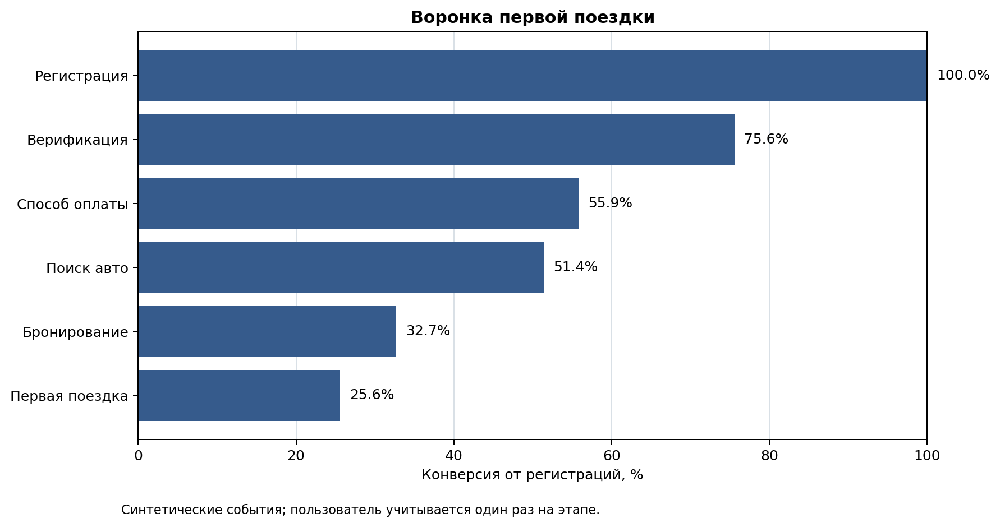
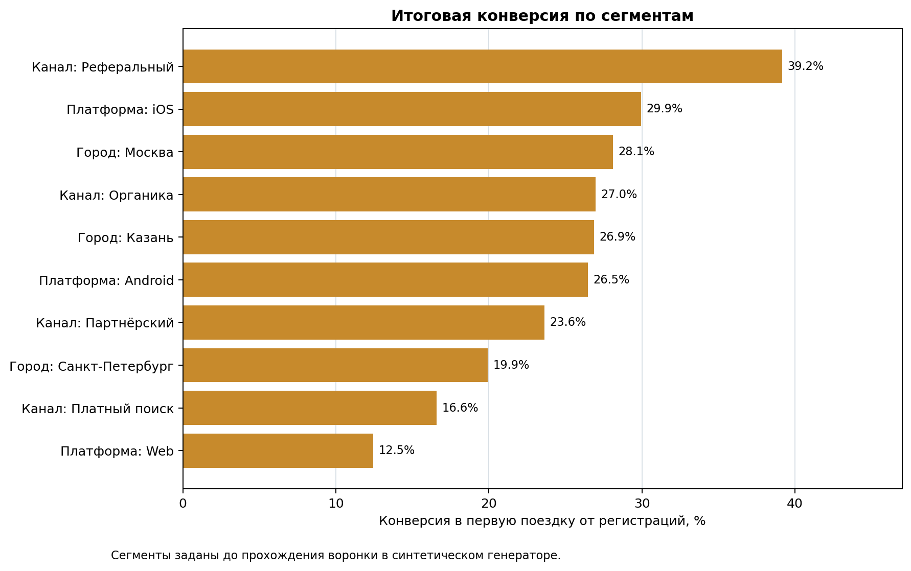
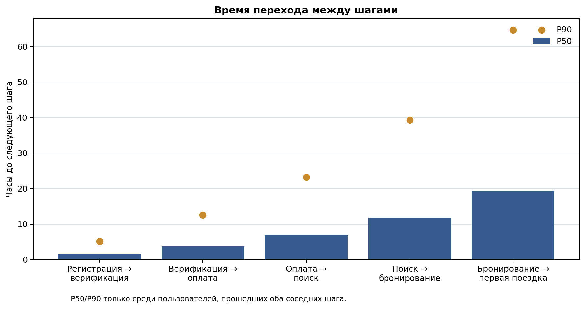
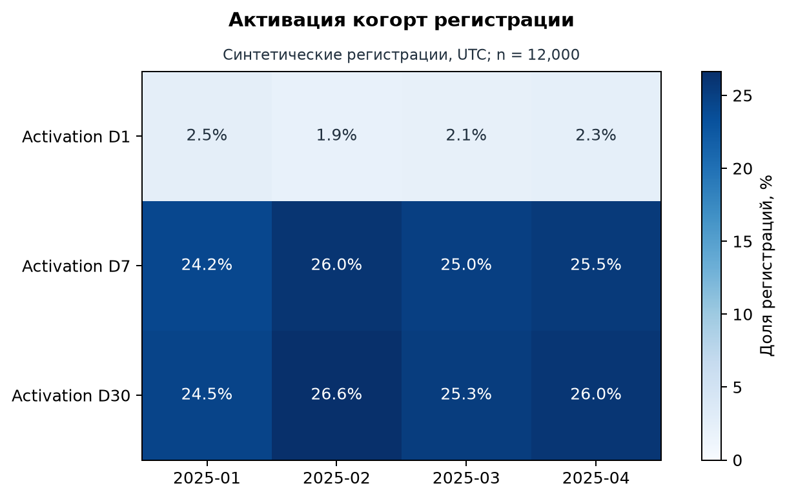

# Воронка первой поездки в каршеринге

## Краткие результаты

- **Из 12,000 регистраций первую поездку совершили 3,068 пользователей (25.6%).** Это описательная оценка на детерминированных синтетических событиях за регистрации с 1 января по 30 апреля 2025 года, а не данные реального оператора.
- **Максимальная потеря в людях — Верификация:** выбыло 2,930 пользователей; конверсия предыдущего шага — 75.6%.
- **Минимальная конверсия соседнего шага — Бронирование:** 63.7%; выбыло 2,240 пользователей. Абсолютная потеря и доля оттока отвечают на разные вопросы.
- **Сегментный разрыв заметен:** лучший итоговый сегмент — Канал / Реферальный (39.2%), слабейший — Платформа / Web (12.5%). Это факт симуляции, не причинный вывод.

## Как считаются метрики

Единица анализа — уникальный `user_id`, зарегистрировавшийся в окне 1 января — 30 апреля 2025 (UTC). На каждом шаге берётся **самое раннее** событие пользователя; следующий шаг засчитывается только если он произошёл не раньше предыдущего. Одно событие не может добавить пользователя дважды.

Конверсия шага — пользователи на шаге / пользователи на предшествующем шаге. Итоговая конверсия — пользователи с `first_ride` / все `signup`. Окно конверсии составляет 30 дней с регистрации: все регистрации взяты достаточно рано, чтобы окно завершилось до даты среза 30 июня 2025. Подробнее — в [методике](../docs/methodology.md).

## Абсолютная потеря и конверсия шага — разные критерии

**На этапе «Верификация» теряется больше всего людей — 2,930.** При этом худшая конверсия перехода — «Бронирование»: 63.7%. На графике показана кумулятивная конверсия; таблица сохраняет оба знаменателя. Приоритет эксперимента зависит также от причин оттока, ожидаемого прироста итоговой конверсии и стоимости изменений — одним числом drop-off его не определить.

| stage          |   users | conversion_from_signup   | conversion_from_previous_stage   |   dropoff_users |
|:---------------|--------:|:-------------------------|:---------------------------------|----------------:|
| Регистрация    |   12000 | 100.0%                   | 100.0%                           |               0 |
| Верификация    |    9070 | 75.6%                    | 75.6%                            |            2930 |
| Способ оплаты  |    6704 | 55.9%                    | 73.9%                            |            2366 |
| Поиск авто     |    6167 | 51.4%                    | 92.0%                            |             537 |
| Бронирование   |    3927 | 32.7%                    | 63.7%                            |            2240 |
| Первая поездка |    3068 | 25.6%                    | 78.1%                            |             859 |

## Платформа и город локализуют точки внимания, но не доказывают причины

**На этапе добавления оплаты слабее всего Web: 60.2% от верифицированных пользователей.** На этапе поиска → бронирования минимум у сегмента «Санкт-Петербург»: 56.8%. Сегменты заданы до событий, поэтому они подходят для приоритизации диагностики; без эксперимента или логов ошибок причинность не установлена.

**Факт:** верификация → способ оплаты конвертирует 73.9%, а бронирование → первая поездка — 78.1%. **Гипотезы:** на оплате web-поток может проигрывать из-за UX/3DS или способов оплаты; в сегменте «Санкт-Петербург» возможны дефицит подходящих машин, цена либо прозрачность условий; после бронирования — отмены, неуверенность в начале аренды или операционные барьеры. Эти механизмы не измеряются текущим event log.

## Скорость прохождения: хвост ожидания важнее среднего

**P90 времени до следующего шага заметно выше P50, поэтому среднее скроет длинный хвост.** Метрика рассчитана только среди прошедших оба соседних шага и не приписывает время пользователям, остановившимся воронке.

| transition                    |   users_reaching_both_steps |   p50_hours |   p90_hours |
|:------------------------------|----------------------------:|------------:|------------:|
| Регистрация → верификация     |                        9070 |         1.5 |         5.2 |
| Верификация → оплата          |                        6704 |         3.8 |        12.6 |
| Оплата → поиск                |                        6167 |         7   |        23.2 |
| Поиск → бронирование          |                        3927 |        11.8 |        39.3 |
| Бронирование → первая поездка |                        3068 |        19.4 |        64.7 |

## Когорты: activation и retention разделены

**Activation D1/D7/D30** — доля всех регистраций когорты, завершивших первую поездку в течение 1/7/30 суток с регистрации. **Retention D1/D7/D30** — доля активированных пользователей, для которых уже прошло соответствующее окно, совершивших следующую завершённую поездку в интервале [D, D+1) от первой поездки. У retention другой знаменатель, поэтому эти две метрики нельзя напрямую сравнивать.

| signup_cohort   |   registrations | activation_d1   | activation_d7   | activation_d30   | retention_d1   | retention_d7   | retention_d30   |
|:----------------|----------------:|:----------------|:----------------|:-----------------|:---------------|:---------------|:----------------|
| 2025-01         |            3111 | 2.5%            | 24.2%           | 24.5%            | 37.9%          | 26.5%          | 17.6%           |
| 2025-02         |            2729 | 1.9%            | 26.0%           | 26.6%            | 37.8%          | 27.0%          | 17.5%           |
| 2025-03         |            3146 | 2.1%            | 25.0%           | 25.3%            | 36.9%          | 26.9%          | 19.2%           |
| 2025-04         |            3014 | 2.3%            | 25.5%           | 26.0%            | 37.5%          | 27.3%          | 19.5%           |

## Что проверять следующим экспериментом

1. **Поток оплаты на web.** A/B: явно показать поддерживаемые способы оплаты и обрабатывать возврат из 3DS. Основная метрика — verification → payment_method; guardrail — error rate оплаты и time-to-payment. Стратифицировать по каналу и городу; не объявлять победу без доверительного интервала для разницы долей.
2. **Поиск → бронирование в сегменте «Санкт-Петербург».** A/B: показать доступные рядом авто и полную цену до CTA либо предложить альтернативные классы. Основная метрика — search → booking; guardrail — отмены, стоимость скидок и жалобы. Перед тестом добавить события результатов поиска: количество машин, ETA, цена, экран/ошибка.
3. **Бронирование → первая поездка.** A/B: контекстное напоминание до начала брони и пошаговый старт аренды. Основная метрика — booking → first_ride; guardrail — отмена брони, обращения в поддержку, D7 retention. Измерять intent-to-treat от момента бронирования.

## Проверка качества и ограничения

**Проверки пройдены: да.** SQL проверяет дубли `event_id`, обязательные поля, допустимые имена событий, дату среза и порядок шагов; отдельные pytest-проверки подтверждают монотонность воронки и порядок событий. Результаты описательны: синтетический генератор намеренно задаёт различия между сегментами. В логе нет причин событий, цен, наличия машин, отказов платёжного провайдера, отмен или реального эксперимента — поэтому рекомендации являются планом проверки, а не доказанными причинами.

## Что проверить дальше

- Как меняется search → booking при одинаковой доступности машин, цене и ETA?
- Какие конкретные ошибки или возвраты из 3DS происходят в web-потоке оплаты?
- Сколько бронирований отменяется до старта и отличаются ли отмены по городу/каналу?

_Воспроизводимость: `make all`; SQL в `sql/`, pandas/графики в `scripts/run_analysis.py`. Данные синтетические, seed `20250812`._
